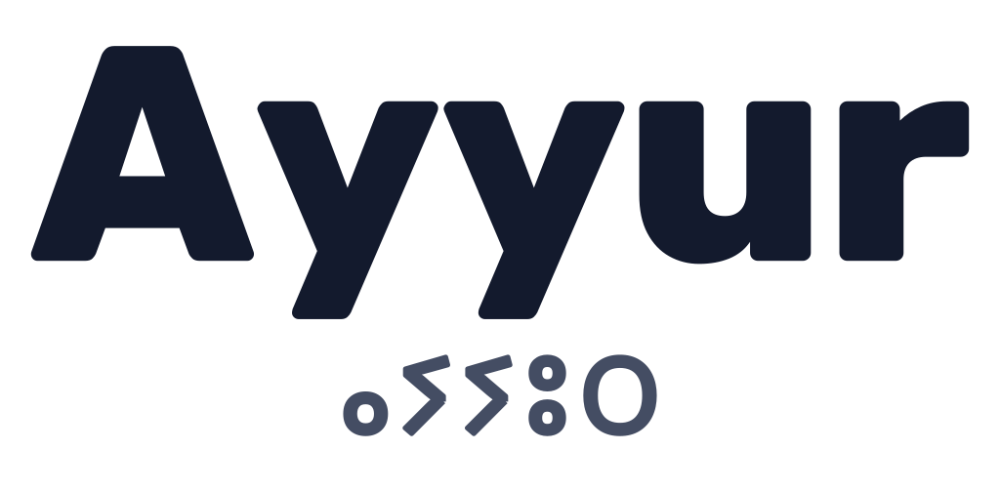

<p align="center">
  
</p>

<p align="center">
  <picture>
    <source media="(prefers-color-scheme: dark)" srcset="assets/brand/logo/ayyur-wordmark-on-dark.png">
    
  </picture>
</p>

<p align="center">
  Your all-in-one Islamic companion for prayer, Quran, fasting, habits and personal growth.<br>
  Private by design, powered by AI.
</p>

---

Ayyur (ⴰⵢⵢⵓⵔ) means "moon" and "month" in Tamazight. The app helps Muslims organise their worship and stay consistent: tracking the five daily prayers, Ramadan and voluntary fasts, Quran reading and memorisation, habits, and tasks, with streaks that encourage without guilt.

Core features are free, with no ads. The app works offline and without an account; cloud sync is optional and encrypts data on the device before upload.

> **Status:** early development. The project is scaffolded and the design system is in place. No features are built yet.

## Meet Ayyur

<p>
  
  
  
  
  
  
</p>

The moon is the mascot and the AI companion. It celebrates progress, and it stays out of the way during worship.

## Stack

- [Expo](https://expo.dev) SDK 57 and React Native 0.86, in TypeScript
- [NativeWind](https://www.nativewind.dev) 4 with Tailwind CSS 3 for styling
- Rubik for interface type

Planned: SQLite on device as the source of truth, Clerk for optional sign-in, and Convex for encrypted sync.

## Getting started

```bash
npm install
npm start
```

Then open the app in Expo Go, or press `a` for Android or `i` for iOS.

| Command | What it does |
| --- | --- |
| `npm start` | Start the dev server |
| `npm run android` / `npm run ios` | Start and open on a device or emulator |
| `npm run lint` | Lint with ESLint |
| `npx tsc --noEmit` | Typecheck |
| `npm run brand` | Regenerate the mascot, logo and icons from `scripts/brand/generate.mjs` |

## Design

- [`PRODUCT.md`](PRODUCT.md): who Ayyur is for, its personality and its principles.
- [`DESIGN.md`](DESIGN.md): colours, type, components and the rules for using them.
- Tokens live in `tailwind.config.js` and `global.css`. Brand assets live in `assets/brand/`.
